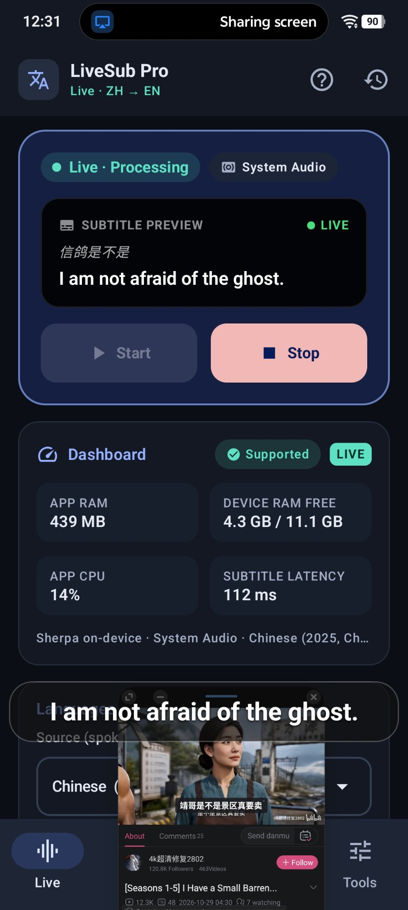
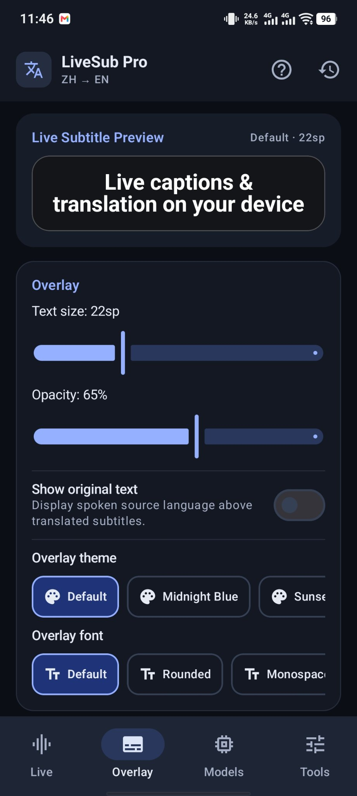
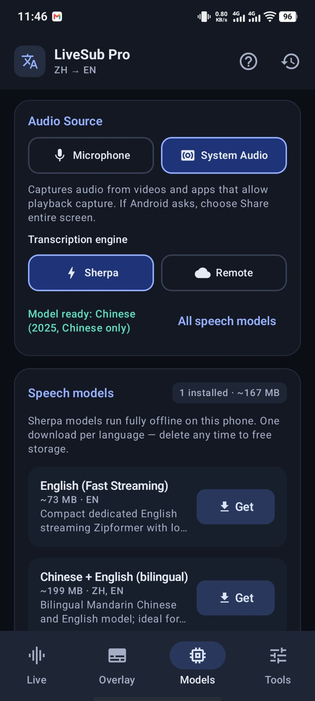

# LiveSub Pro

**Real-time offline speech recognition, neural translation, and cinema-grade floating subtitles for Android.**

Modified and engineered by **[SiAM](https://github.com/siam38)**, based on [LiveCaptionN](https://github.com/chartmann1590/LiveTranscribe-Android) by [Charles Hartmann](https://github.com/chartmann1590).

[](https://github.com/siam38/LiveSub-Pro/releases/latest)
[](LICENSE)
[-131822)](#requirements)

Watch a drama, lecture, video, or live stream in another language and get real-time floating subtitles over any app. Speech is conditioned and recognized **on your device** with [Sherpa-ONNX](https://github.com/k2-fsa/sherpa-onnx) streaming models, translated on-device with Google ML Kit, and presented in a responsive subtitle dock — with no account, no subscription, and no ads.

---

## Key Highlights

- **Zero-Blackout Cinema Subtitles** — Displays stabilized cues in a bottom dock with optional bilingual original lines, progressive clause-boundary preview translation for long utterances, and instant pass-through for same-language live captioning.
- **Signal-Conditioned Audio Capture** — Supports both **System Audio** (`AudioPlaybackCapture` via `MediaProjection` on Android 10+) and **Microphone** capture, processed through a real-time DC-offset filter and envelope-tracked Adaptive Gain Control (AGC) to recover quiet media streams without clipping.
- **Hypothesis Stabilization & Loop Suppression** — Automatically suppresses transducer repetition loops (consecutive word/bigram/CJK repeats during background music) and stabilizes frame-edge partial jitter.
- **In-App Model Manager with Resume & Cancel** — Download only the language packs you need from HuggingFace with HTTP Range resumption, free-space verification, live MB progress, download cancellation, and one-tap deletion.
- **On-Device Neural Translation** — Powered by Google ML Kit (~59 languages, fully offline after a one-time ~30 MB model download, including automatic Cantonese `yue → zh` normalization) or your own self-hosted LibreTranslate server.
- **Studio Workspace UI** — Organized into 4 focused tabs (**Live**, **Overlay**, **Models**, **Tools**) with an interactive live overlay style preview, named presets, pre/post translation glossary with case-sensitivity, and searchable history with `.txt`, `.srt`, and `.json` export.
- **Properly Fast** — Transcription and translation run fully on-device, so a finished line is translated and on screen in well under a second. The latency number in the dashboard (and in the floating box when you tap it) is the honest end-to-end one: from the end of the spoken line to the translated subtitle showing.

---

## Screenshots

| Live | Overlay | Models |
| :---: | :---: | :---: |
|  |  |  |
| Start/stop, subtitle preview and a live dashboard (RAM, CPU, latency). The floating subtitle on top is the overlay doing its job. | Text size, opacity, themes and fonts for the floating subtitles, with a live preview. | System Audio or Mic, Sherpa on-device or Remote — and you only download the language models you actually need. |

---

## On-Device Speech Models (Sherpa-ONNX 2.0.1)

Models are downloaded on demand in-app from HuggingFace:

| Model ID | Display Name | Supported Languages | Size | Architecture |
| :--- | :--- | :--- | :--- | :--- |
| `en-2023` | **English (Fast Streaming)** | English (`en`) | ~73 MB | Streaming Zipformer Transducer (INT8) |
| `zh-2025` | **Chinese (2025, Chinese only)** | Mandarin Chinese (`zh`) | ~167 MB | Streaming Zipformer Transducer (INT8) |
| `bilingual-zh-en` | **Chinese + English (bilingual)** | Chinese (`zh`), English (`en`) | ~199 MB | Streaming Zipformer Transducer (INT8) |
| `ko-2024` | **Korean** | Korean (`ko`) | ~132 MB | Streaming Zipformer Transducer (INT8) |
| `fr-2023` | **French** | French (`fr`) | ~128 MB | Streaming Zipformer Transducer (INT8) |
| `ru-tone` | **Russian** | Russian (`ru`) | ~144 MB | Streaming T-One CTC |
| `yue-paraformer` | **Cantonese + Chinese + English** | Cantonese (`yue`), Chinese (`zh`), English (`en`) | ~239 MB | Streaming Paraformer (INT8) |
| `multi-2025` | **Multilingual (8-language pack)** | Japanese (`ja`), Arabic (`ar`), Indonesian (`id`), Thai (`th`), Vietnamese (`vi`), Russian (`ru`), Chinese (`zh`), English (`en`) | ~339 MB | Streaming Zipformer + BPE (INT8) |

> **Compatibility Fallback:** If you already have `bilingual-zh-en` or `multi-2025` installed, LiveSub Pro automatically reuses it when you select English (`en`) or Chinese (`zh`) without forcing an extra download.

---

## Architecture & Pipeline

```
AudioRecord (Mic / AudioPlaybackCapture 16 kHz Mono PCM16)
  │
  ▼
AudioPreprocessor (High-pass DC-blocker + Adaptive RMS/Peak AGC + Soft Limiter)
  │
  ▼
Sherpa-ONNX 2.0.1 OnlineRecognizer (0.5s phrase pause / 7.0s max segment endpointing)
  │
  ▼
PartialHypothesisStabilizer (N-gram/CJK loop filter + Clause-boundary detector)
  │
  ▼
CaptionForegroundService (Pre/Post Glossary + Same-language fast path + Clause preview)
  │
  ├──► MlKitTranslationRepository / LibreTranslateRepository (Bounded LRU + 300-entry cache)
  ├──► OverlayController (Screen-clamped, center-snapping floating subtitle dock)
  └──► TranscriptHistoryStore (Local JSON store with .txt / .srt / .json export)
```

For a comprehensive engineering breakdown of the system architecture and audit findings, see [AUDIT.md](AUDIT.md).

---

## Requirements

- **Android 8.0 (API 26)+** for Microphone captioning; **Android 10 (API 29)+** for System Audio capture.
- **Recommended Hardware:** 64-bit ARM (`arm64-v8a`), 4 GB+ RAM, 4+ CPU cores for on-device Sherpa-ONNX + ML Kit. Devices below 2.5 GB RAM automatically fall back to self-hosted Remote Whisper & LibreTranslate mode.

---

## Building via GitHub Actions

All compilation, unit testing, and APK generation run automatically in GitHub Actions (`.github/workflows/build.yml`). On every push or manual `workflow_dispatch`:
1. Fetches the `sherpa-onnx-2.0.1.aar` runtime, Gradle wrapper jar, and tutorial video.
2. Runs the full unit test suite (`./gradlew testGithubDebugUnitTest`) and uploads test report artifacts.
3. Builds and signs the installable debug APK (`./gradlew assembleGithubDebug`) and uploads `LiveSub-Pro-v1.0.<run_number>.apk` as a workflow artifact.

To verify all HuggingFace model URLs in the catalog:
```bash
python tools/check_model_links.py
```

---

## Credits & License

- Engineered and redesigned by **[SiAM](https://github.com/siam38)**.
- Based on [LiveCaptionN / LiveTranscribe-Android](https://github.com/chartmann1590/LiveTranscribe-Android) by **[Charles Hartmann (chartmann1590)](https://github.com/chartmann1590)**.
- Speech recognition runtime and models by [k2-fsa / sherpa-onnx](https://github.com/k2-fsa/sherpa-onnx).
- Licensed under the [MIT License](LICENSE).
