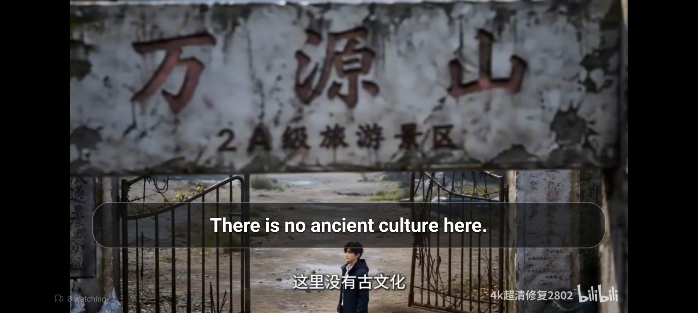
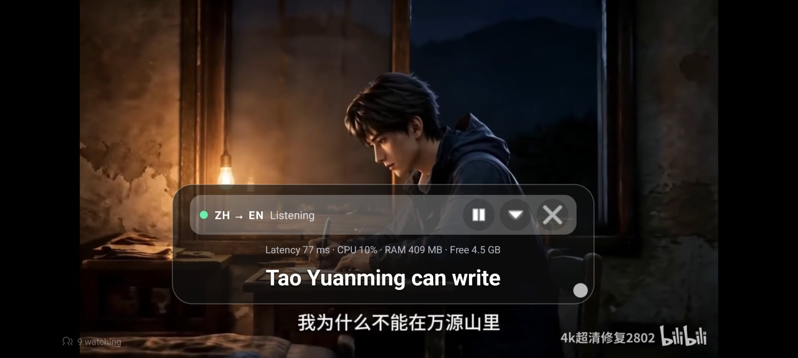

# LiveSub Pro

Live subtitles for Android. Watch a video, drama, lecture or stream in another language and read it in yours, in a floating box over any app.

Modified and engineered by **[SiAM](https://github.com/siam38)**, based on [LiveCaptionN](https://github.com/chartmann1590/LiveTranscribe-Android) by [Charles Hartmann](https://github.com/chartmann1590).

[](https://github.com/siam38/LiveSub-Pro/releases/latest)
[](https://github.com/siam38/LiveSub-Pro/actions/workflows/build.yml)
[](LICENSE)
[-131822)](#requirements)
[](https://github.com/siam38/LiveSub-Pro)
[](https://github.com/k2-fsa/sherpa-onnx)
[](https://github.com/siam38/LiveSub-Pro/releases/latest)

Speech is conditioned and recognized **on your device** with [Sherpa-ONNX](https://github.com/k2-fsa/sherpa-onnx) streaming models, translated on-device with Google ML Kit, and presented in a responsive subtitle dock — with no account, no subscription, and no ads.

---

## Key Highlights

- **Zero-Blackout Cinema Subtitles** — Displays stabilized cues in a bottom dock with optional bilingual original lines, progressive clause-boundary preview translation for long utterances, and instant pass-through for same-language live captioning.
- **Signal-Conditioned Audio Capture** — Supports both **System Audio** (`AudioPlaybackCapture` via `MediaProjection` on Android 10+) and **Microphone** capture, processed through a real-time DC-offset filter and envelope-tracked Adaptive Gain Control (AGC) to recover quiet media streams without clipping.
- **Hypothesis Stabilization & Loop Suppression** — Automatically suppresses transducer repetition loops (consecutive word/bigram/CJK repeats during background music) and stabilizes frame-edge partial jitter.
- **In-App Model Manager with Resume & Cancel** — Download only the language packs you need from HuggingFace with HTTP Range resumption, free-space verification, live MB progress, download cancellation, and one-tap deletion.
- **On-Device Neural Translation** — Powered by Google ML Kit (~59 languages, fully offline after a one-time ~30 MB model download, including automatic Cantonese `yue → zh` normalization) or your own self-hosted LibreTranslate server.
- **Studio Workspace UI** — Organized into 4 focused tabs (**Live**, **Overlay**, **Models**, **Tools**) with an interactive live overlay style preview, named presets, pre/post translation glossary with case-sensitivity, and searchable history with `.txt`, `.srt`, and `.json` export.
- **Live Dashboard & In-Box Stats** — A dashboard on the Live tab shows App RAM, free device RAM, App CPU and overall subtitle latency live, next to a Supported / Limited / Unsupported device mark. Tap the floating box while you watch and the same stats run in a small line under its controls: latency, CPU, RAM and free memory, fitted inside the box.
- **Properly Fast** — Transcription and translation run fully on-device, so a finished line is translated and on screen in well under a second. The latency number in the dashboard (and in the floating box when you tap it) is the honest end-to-end one: from the end of the spoken line to the translated subtitle showing.

---

## Screenshots

| Live | Overlay | Models |
| :---: | :---: | :---: |
|  |  |  |
| Start/stop, subtitle preview and a live dashboard (RAM, CPU, latency). The latency in this shot is 112 ms, the overall time from the end of the spoken line to the translated subtitle on screen. The floating subtitle on top is the overlay doing its job. | Text size, opacity, themes and fonts for the floating subtitles, with a live preview. | System Audio or Mic, Sherpa on-device or Remote — and you only download the language models you actually need. |

| Subtitles only | Tap for controls and stats |
| :---: | :---: |
|  |  |
| Left alone, the box is just the translated line over your video. Nothing else on screen. | Tap the box and the controls appear: language pair, pause, minimise and close. Under them runs a small live stats line with latency (77 ms in this shot), CPU, app RAM and free device memory. |

---

## On-Device Speech Models (Sherpa-ONNX 2.0.1)

Models are downloaded on demand in-app from HuggingFace:

| Model ID | Display Name | Supported Languages | Size | Architecture |
| :--- | :--- | :--- | :--- | :--- |
| `en-2023` | **English (Fast Streaming)** | English (`en`) | ~73 MB | Streaming Zipformer Transducer (INT8) |
| `zh-2025` | **Chinese (2025, Chinese only)** | Mandarin Chinese (`zh`) | ~167 MB | Streaming Zipformer Transducer (INT8) |
| `bilingual-zh-en` | **Chinese + English (bilingual)** | Chinese (`zh`), English (`en`) | ~199 MB | Streaming Zipformer Transducer (INT8) |
| `ko-2024` | **Korean** | Korean (`ko`) | ~132 MB | Streaming Zipformer Transducer (INT8) |
| `fr-2023` | **French** | French (`fr`) | ~128 MB | Streaming Zipformer Transducer (INT8) |
| `ru-tone` | **Russian** | Russian (`ru`) | ~144 MB | Streaming T-One CTC |
| `yue-paraformer` | **Cantonese + Chinese + English** | Cantonese (`yue`), Chinese (`zh`), English (`en`) | ~239 MB | Streaming Paraformer (INT8) |
| `multi-2025` | **Multilingual (8-language pack)** | Japanese (`ja`), Arabic (`ar`), Indonesian (`id`), Thai (`th`), Vietnamese (`vi`), Russian (`ru`), Chinese (`zh`), English (`en`) | ~339 MB | Streaming Zipformer + BPE (INT8) |

> **Compatibility Fallback:** If you already have `bilingual-zh-en` or `multi-2025` installed, LiveSub Pro automatically reuses it when you select English (`en`) or Chinese (`zh`) without forcing an extra download.

---

## Architecture & Pipeline

```
AudioRecord (Mic / AudioPlaybackCapture 16 kHz Mono PCM16)
  │
  ▼
AudioPreprocessor (High-pass DC-blocker + Adaptive RMS/Peak AGC + Soft Limiter)
  │
  ▼
Sherpa-ONNX 2.0.1 OnlineRecognizer (0.5s phrase pause / 7.0s max segment endpointing)
  │
  ▼
PartialHypothesisStabilizer (N-gram/CJK loop filter + Clause-boundary detector)
  │
  ▼
CaptionForegroundService (Pre/Post Glossary + Same-language fast path + Clause preview)
  │
  ├──► MlKitTranslationRepository / LibreTranslateRepository (Bounded LRU + 300-entry cache)
  ├──► OverlayController (Screen-clamped, center-snapping floating subtitle dock)
  └──► TranscriptHistoryStore (Local JSON store with .txt / .srt / .json export)
```

---

## Requirements

- **Android 8.0 (API 26)+** for Microphone captioning; **Android 10 (API 29)+** for System Audio capture.
- **Recommended Hardware:** 64-bit ARM (`arm64-v8a`), 4 GB+ RAM, 4+ CPU cores for on-device Sherpa-ONNX + ML Kit. Devices below 2.5 GB RAM automatically fall back to self-hosted Remote Whisper & LibreTranslate mode.

---

## Install

1. Download the latest APK from [Releases](https://github.com/siam38/LiveSub-Pro/releases/latest).
2. Open the file and allow install when Android asks. No account or sign-up is needed.
3. Open LiveSub Pro and follow the short first-run setup: permissions, your languages, then your speech model download.
4. Pick System Audio, tap Start, allow screen capture, and play your video.

New versions install over the old one, so your downloaded model and your settings are kept.

---

## Contributors

- **[SiAM](https://github.com/siam38)** — Modified and engineered LiveSub Pro: the redesign, on-device Sherpa engine, dashboard, floating box and current feature set.
- **[Charles Hartmann](https://github.com/chartmann1590)** — Author of the original LiveCaptionN app this project is based on.

Bug reports and ideas are welcome through [Issues](https://github.com/siam38/LiveSub-Pro/issues), and pull requests are welcome too.

---

## Credits & License

- Modified and engineered by **[SiAM](https://github.com/siam38)**.
- Based on [LiveCaptionN / LiveTranscribe-Android](https://github.com/chartmann1590/LiveTranscribe-Android) by **[Charles Hartmann (chartmann1590)](https://github.com/chartmann1590)**.
- Speech recognition runtime and models by [k2-fsa / sherpa-onnx](https://github.com/k2-fsa/sherpa-onnx).
- Licensed under the [MIT License](LICENSE).
